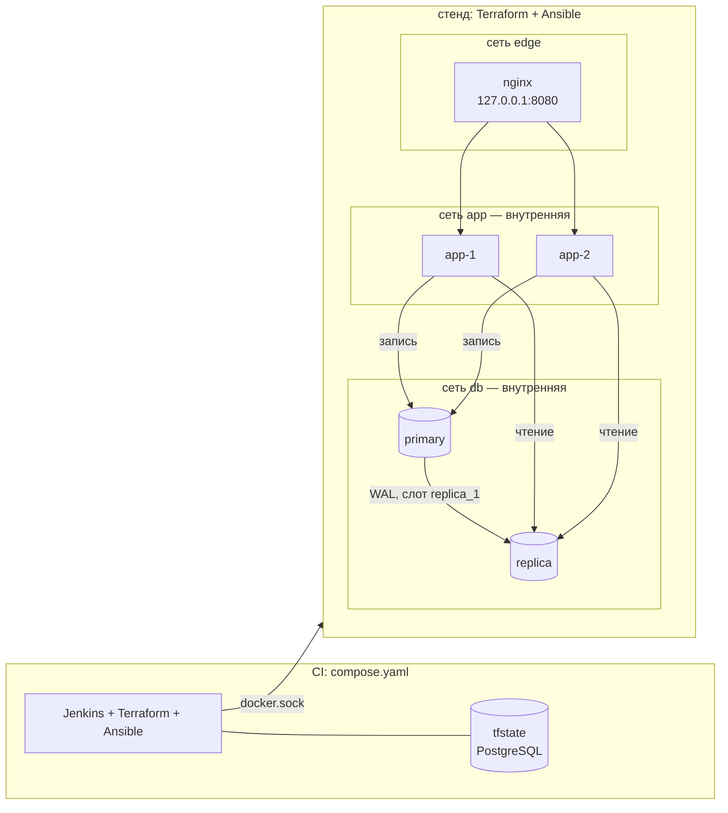

# iac-stand — Jenkins, Terraform и Ansible: стенд с репликацией PostgreSQL

Стенд целиком создаётся из кода на одном ноутбуке:
- три изолированных сегмента сети;
- PostgreSQL с потоковой репликой;
- nginx как единственная точка входа;
- сервис заказов в двух экземплярах.

Jenkins, настроенный как код, проводит каждое изменение через одну и ту же цепочку:
проверки → образ → Terraform → выкат Ansible → проверка живого стенда. Неудачный релиз Ansible
откатывает сам, и сервис при этом не перестаёт отвечать.

**Стек:** Terraform 1.16 (провайдер Docker 4.6, состояние в PostgreSQL) · Ansible 2.21
(community.docker) · Jenkins LTS (Configuration as Code, Job DSL) · Docker · PostgreSQL 16
(потоковая репликация) · nginx · Python 3 / FastAPI / psycopg · pytest · ansible-lint · ruff.

```text
Jenkins (сборка 8)                                     Jenkins (сборка 9, BAD_RELEASE=true)
  Проверки        All checks passed! 30 passed          …
  Образ           stand-app:8                           Выкат  stand-app:9 не прошёл проверку здоровья.
  Инфраструктура  Apply complete! 0 added, 0 changed,          Возвращена stand-app:8
                  0 destroyed                           результат: FAILURE
  Выкат           stand: ok=28 changed=10 failed=0      $ docker inspect stand-app-1 stand-app-2
  Проверка стенда 16 passed in 210.31s                    /stand-app-1 stand-app:8 healthy
  результат: SUCCESS                                      /stand-app-2 stand-app:8 healthy
```

## Как устроено



| Кто | За что отвечает | Почему так |
|---|---|---|
| **Terraform** (`terraform/`) | сети с подсетями и шлюзами, тома, основная база и реплика, nginx, пароли (`random_password`) | долгоживущая инфраструктура: её состояние нужно хранить и сравнивать с кодом |
| **Ansible** (`ansible/`) | роль сервиса в базе, миграции, поочерёдная замена экземпляров, конфигурация nginx, откат | релиз — это последовательность шагов с проверками; Terraform плохо умеет «по одному, с ожиданием здоровья» |
| **Jenkins** (`Jenkinsfile`, `jenkins/casc.yaml`) | порядок шагов, секреты, отчёты JUnit | каждая стадия — цель `Makefile`; разработчик запускает то же самое у себя |
| **Тесты** (`tests/`) | политики репозитория без Docker; живой стенд — сеть, права, репликация, выкат и откат | проверяется результат, а не то, что команды отработали без ошибки |

### Сеть

Три сегмента. `app` и `db` внутренние (`internal = true`): из них нет выхода наружу, а с хоста
в них не попасть. Наружу открыт один порт nginx, и только на `127.0.0.1`. Тест проверяет
связность на живом стенде: пробные контейнеры в каждом сегменте пытаются подключиться ко всем
остальным, по имени и по IP-адресу.

| откуда \ куда | nginx | app | primary | replica | primary по IP | интернет |
|---|---|---|---|---|---|---|
| edge | ✓ | — | — | — | — | |
| app | ✓ | ✓ | — | — | — | — |
| db | — | ✓ | ✓ | ✓ | ✓ | — |

Из сегмента баз виден сервис: сети Docker делят трафик на сегменты, но не задают направление.
Ограничить, кто инициирует соединение, можно только правилами iptables на хосте. Здесь этого нет,
и тест записывает такое поведение как ожидаемое, а не скрывает его.

### Репликация

Основная база создаёт роль `replicator` и физический слот `replica_1`. Слот не даёт удалить WAL,
который реплика ещё не забрала. Реплика при первом запуске делает `pg_basebackup -R` и дальше
работает в режиме горячего резерва. Проверка здоровья реплики — `pg_is_in_recovery()`:
реплика, по ошибке поднятая как самостоятельная база, здоровой не считается.

Сервис пишет в основную базу, а читает с реплики. Репликация асинхронная, поэтому только что
созданного заказа на реплике может ещё не быть. Тогда сервис читает из основной базы и сообщает
об этом заголовком `X-Read-From: primary`.

Доступ к базам задаёт `pg_hba.conf`:
- репликация — только роли `replicator`;
- база `orders` — только роли `app`;
- обе — только из подсети `db`;
- всё остальное запрещено.

Суперпользователь по сети не подключится, и это проверяет тест. Роль сервиса может читать и вставлять,
но не может менять и удалять.

### Выкат и откат

Ansible меняет экземпляры по одному:
1. выводит экземпляр из nginx (`nginx -t && nginx -s reload`);
2. поднимает новую версию;
3. ждёт проверку здоровья из образа;
4. возвращает экземпляр в балансировку.

Если новая версия не поднялась, блок `rescue` возвращает предыдущий образ на все экземпляры
и проваливает релиз. Учебная авария `BAD_RELEASE=true` выкатывает релиз с неверным паролем базы:
это ошибка конфигурации, а не кода, то есть самый частый вид неудачного релиза.

Тесты выката идут под нагрузкой. Проба в сети `edge` непрерывно спрашивает `/version`,
пока Ansible меняет экземпляры. Отвечать она должна только 200 — и при обычном выкате,
и при неудачном с откатом.

## Как запустить

Нужен Docker. Всё остальное — в образе `jenkins/Dockerfile`.

```bash
scripts/init-env.sh                      # .env со случайными паролями (один раз)
docker compose up -d --build             # Jenkins: http://127.0.0.1:8088, пользователь admin, пароль — в .env
docker compose run --rm tools up VERSION=1          # образ → Terraform → выкат → проверка стенда
docker compose run --rm tools deploy VERSION=1 BAD=true   # учебная авария: релиз откатится
docker compose run --rm tools check      # проверки без Docker и без состояния
docker compose run --rm tools down       # снять сервис и инфраструктуру
docker compose exec jenkins bash /src/scripts/jenkins-build.sh [BAD_RELEASE=true]   # сборка в Jenkins
```

Jenkins собирает зафиксированное состояние репозитория (`file:///src`, ветка `main`), а не
рабочую папку. Поэтому перед сборкой нужен коммит.

## Как проверялось

- `make check`:
  - `terraform fmt -check` и `validate`;
  - ansible-lint без замечаний;
  - ruff;
  - 30 тестов политик: только nginx публикует порт и только на настроенном адресе; сети `app`
    и `db` внутренние; `pg_hba` запрещает всё неразрешённое; в compose нет root, привилегий
    и открытых портов; секретов в репозитории нет; каждая стадия Jenkinsfile — цель Makefile;
    инвентарь из выходов Terraform; проверка плана.
- `make test` — 16 проверок живого стенда, около 3,5 мин:
  - сегментация сети по имени и по IP;
  - опубликованные порты;
  - права сервиса и nginx;
  - запрет суперпользователю по сети;
  - репликация через слот и реплика только для чтения;
  - заказ через API виден на реплике;
  - балансировка на два экземпляра;
  - выкат без единого ответа не 200;
  - откат неудачного релиза.
- **Jenkins**: сборки 1–9 на одном стенде. Сборки 1–4 упали и показали ошибки, описанные ниже.
  Сборки 5, 6 и 8 зелёные. Сборки 7 и 9 — учебная авария: релиз проваливается, и стенд
  остаётся на предыдущей версии.
- **Журналы сборок проверены на утечки.** Строки подключения к состоянию и URL базы с паролем
  в них нет. Одна утечка нашлась и исправлена (см. ниже).

### Что нашлось по ходу — и почему в Makefile две лишние строки

- **Первый же прогон в Jenkins удалил контейнеры обеих баз.** Docker сам дописывает шлюз
  в настройки сети, а провайдер Terraform видит в этом разницу с конфигурацией. Из-за этого
  каждый `plan` предлагал пересоздать все три сети, а с ними все подключённые контейнеры.
  Данные уцелели только потому, что лежат в отдельных томах.

  Исправлено с трёх сторон:
  - шлюз задан явно (`cidrhost`);
  - `scripts/plan_guard.py` не даёт применить план, который удаляет или пересоздаёт базу
    или её том, без `ALLOW_DATA_REPLACE=yes`;
  - сразу после `apply` выполняется `plan -detailed-exitcode`: если Terraform снова видит
    изменения, сборка падает.

  Последняя проверка тут же нашла второй дрейф: `memory_swap`, который Docker по умолчанию
  ставит равным удвоенной памяти.
- **Плейбук без инвентаря «успешно» ничего не делал.** Каталог с Windows монтируется в контейнер
  с правами 777, и Ansible молча не читает `ansible.cfg` из каталога, куда может писать любой.
  В итоге хостов нет, «no hosts matched», код возврата 0, и тест отката оказался зелёным
  без всякого отката.

  Теперь у обоих плейбуков первый плей проверяет, что стенд есть в инвентаре, а `-i` передаётся
  явно. Та же проверка через час поймала второй случай: в клоне Jenkins у `terraform.py`
  не было бита исполнения, потому что файл закоммичен с Windows как 644.
- **Пароль базы попадал в журнал Jenkins при неудачном выкате.** Задача ожидания здоровья
  при неудаче печатала весь ответ `docker_container_info`, а в нём `Config.Env`. Теперь
  она работает с `no_log`, а причину сообщает отдельная проверка: статус и вывод последней
  проверки здоровья.
- **`mode: "0644"` модуль `docker_container_copy_into` прочитал как десятичное 644**, то есть
  восьмеричное 1204. Nginx потерял право читать свой конфиг (`--w----r-T`). Теперь там `420`
  и комментарий с объяснением.
- **`.terraform` от прошлой сборки** заставлял `terraform validate` в стадии проверок идти
  за состоянием. У проверок теперь своя папка `TF_DATA_DIR`.

### Не проверялось

- **Облака здесь нет.** Terraform управляет Docker на одной машине. Понятия те же — состояние,
  план, переменные, выходы, удалённое хранилище с блокировкой, — но ресурсы другие. Примерное
  соответствие для Yandex Cloud:

  | Здесь | В облаке |
  |---|---|
  | `docker_network` с подсетью | `yandex_vpc_network` + `yandex_vpc_subnet` |
  | `internal = true`, единственный порт на 127.0.0.1 | группы безопасности, машины без публичного адреса |
  | `docker_container` | `yandex_compute_instance` |
  | `docker_volume` | `yandex_compute_disk` |
  | `backend "pg"` | Object Storage с блокировкой |

  Как это ведёт себя в настоящем облаке, я не проверял.
- **MS SQL и Oracle не использовались.** Репликация показана на PostgreSQL. Механизмы у этих СУБД
  свои: Always On и Data Guard.
- **Переключение на реплику при отказе основной базы не реализовано** (`pg_promote`, Patroni).
  Реплика здесь служит для чтения и как горячий резерв.
- **Jenkins управляет Docker через смонтированный сокет.** Это права root на хосте для всех,
  кто может запустить сборку. Для учебного стенда на одной машине это допустимо, для общего
  Jenkins — нет: там нужен отдельный агент или rootless Docker.
- **Плагины Jenkins не закреплены по версиям.** jenkins-plugin-cli ставит последние совместимые
  и печатает их список в журнал сборки образа. Клиент Docker скачивается по HTTPS без проверки
  контрольной суммы: у статических сборок Docker её нет рядом с архивом.
- **Сборка Jenkins запускалась только на Windows** с Docker Desktop. В GitHub Actions
  или на Linux-сервере она не гонялась. Группа сокета на Linux берётся из `stat`
  в `init-env.sh`.
- **Нагрузку стенд не держал:** выкат проверялся одним потоком запросов с паузой 50 мс.

## Структура

```text
terraform/        сети, базы с репликой, nginx; шаблоны pg_hba, инициализации и запуска реплики
ansible/          deploy.yml и teardown.yml; роли database (роль, миграции, проверка репликации) и release
                  (поочерёдный выкат, nginx, откат); инвентарь из terraform output
jenkins/          образ Jenkins с инструментами, casc.yaml, список плагинов
app/              сервис заказов, Dockerfile, модульные тесты
tests/unit/       политики репозитория, инвентарь, проверка плана — без Docker
tests/infra/      живой стенд: сеть, права, репликация, выкат и откат под нагрузкой
scripts/          init-env.sh, plan_guard.py, jenkins-build.sh
Jenkinsfile, Makefile, compose.yaml
```
